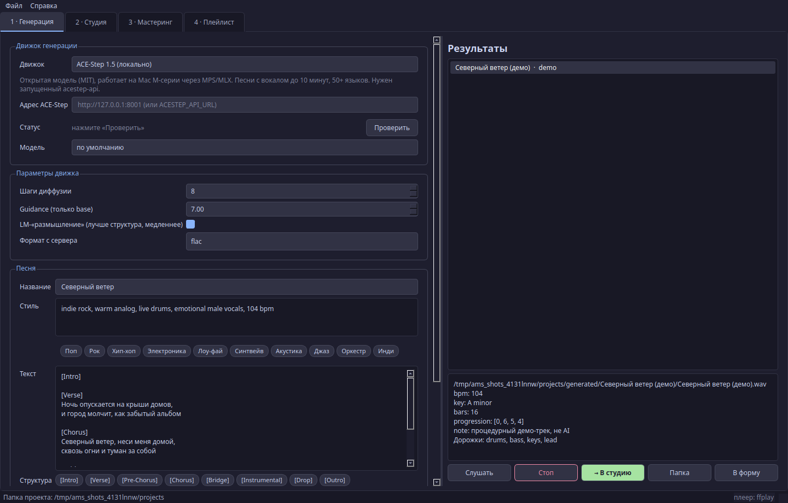
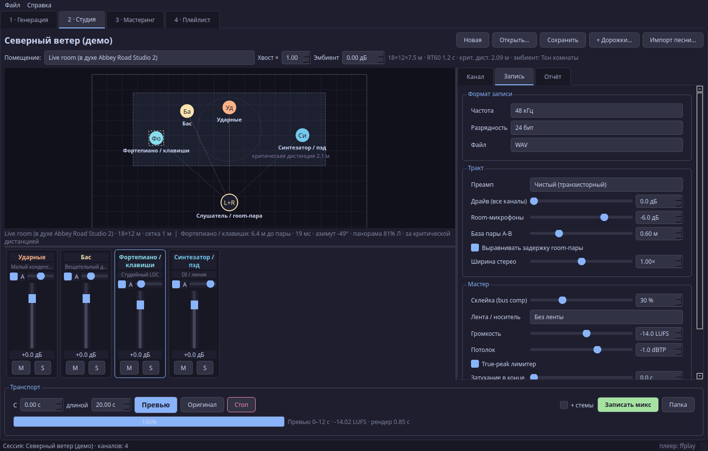
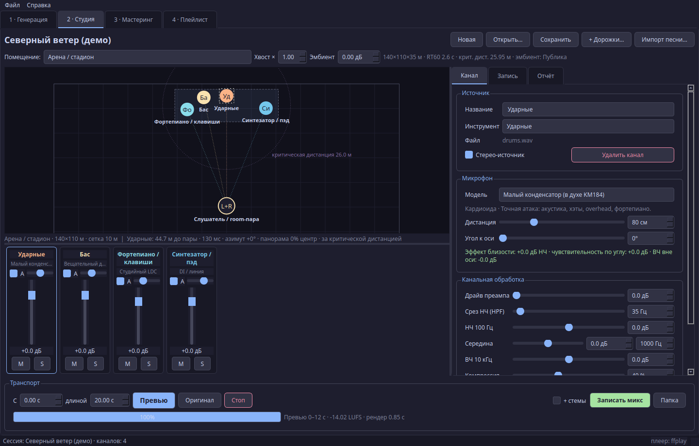

<p align="center">
  
</p>

<p align="center">
  <a href="https://github.com/MRX7999/AI-Music-Studio/actions/workflows/ci.yml"></a>
  <a href="https://github.com/MRX7999/AI-Music-Studio/releases/latest"></a>
  
  
  <a href="LICENSE"></a>
</p>

<p align="center">
  <b>Сгенерируйте песню, расставьте музыкантов на сцене, выберите помещение и микрофоны — и «запишите» трек, как в настоящей студии.</b><br>
  <a href="README_EN.md">English</a>
</p>

---

AI Music Studio — настольное приложение на PyQt5, которое соединяет генерацию песен нейросетью и виртуальную студию звукозаписи. Песня раскладывается на дорожки (вокал, ударные, бас, клавиши…), каждая дорожка становится музыкантом на сцене, а движок записи моделирует помещение, микрофоны, преамп, ленту и мастеринг до целевой громкости.

## Возможности

| | |
|---|---|
| Генерация | ACE-Step 1.5 локально (рекомендуется), Suno через GPTunneL Creative Lab (облако), офлайн демо-синтезатор без сети |
| Форма песни | название, стиль с быстрыми тегами, текст с тегами структуры `[Verse]`/`[Chorus]`, BPM, тональность, размер, язык, seed, число вариантов, параметры движка |
| Дорожки | ACE-Step/демо отдают стемы сразу; готовую песню можно разделить встроенным HPSS или Demucs |
| Сцена | 10 помещений от вокальной будки до арены, перетаскивание музыкантов мышью, критическая дистанция, зум |
| Микрофоны | 12 моделей с АЧХ, диаграммой направленности, эффектом близости и шумом; дистанция и угол к оси |
| Канал | гейн, панорама (авто по положению или вручную), HPF, 3-полосный EQ, компрессор, драйв преампа, посыл в реверберацию, Mute/Solo |
| Запись | 44.1/48/96 кГц, 16/24/32 бит, преамп (чистый, ламповый, трансформаторный, opto), лента/кассета/винил, room-пара A-B, ширина стерео, bus-компрессор |
| Мастер | LUFS по ITU-R BS.1770-4, true-peak лимитер с 4x оверсэмплингом, фейд, дизеринг; экспорт WAV/FLAC/ALAC/MP3 с тегами и обложкой |
| Сессии | `session.studio.json` с относительными путями — папку можно переносить; экспорт стемов после обработки |
| Папка проектов | по умолчанию `~/Music/AI Music Studio`; если macOS не даёт доступа к «Музыке», приложение берёт `~/AI Music Studio` и пишет об этом в строке состояния. Сменить: «Файл → Папка проектов…» |
| Мастеринг-пайплайн | исходный `full_pipeline.py` (AudioSR, Whisper, спектры) встроен вкладкой |
| CLI | всё то же без интерфейса: `generate`, `session`, `render`, `list` |

## Скриншоты

| Генерация | Студия |
|---|---|
|  |  |
| Параметры записи | Арена |
|  |  |

## Как это работает

```text
1 · Генерация          2 · Студия                                         Файл
ACE-Step / Suno /  →   стемы → музыканты на сцене → микрофоны → запись →  WAV / FLAC
демо                   (или разделение готовой песни: HPSS / Demucs)      ALAC / MP3
```

Цепочка канала и мастера (см. `studio/render.py`):

```text
стем → микрофон (АЧХ, диаграмма, близость, шум) → преамп → HPF/EQ → компрессор → фейдер
     ├─► близкий микрофон: панорама по положению на сцене        → dry-шина
     ├─► room-пара A-B: прямой звук + ранние отражения помещения  → room-шина
     └─► посыл в диффузный хвост помещения                        → reverb-шина
мастер: dry + room + reverb + эмбиент → ширина → bus-компрессор → лента
        → нормализация LUFS + true-peak лимитер → фейд → дизеринг → файл
```

Положение музыканта относительно слушателя определяет задержку, затухание по расстоянию, панораму и долю прямого звука к отражённому. Ранние отражения считаются методом мнимых источников по размерам помещения, хвост — диффузной реверберацией с заданным RT60.

## Помещения

| ID | Помещение | Размер | RT60 |
|---|---|---|---|
| `dry` | Сухо (без помещения) | 6×6×3 м | 0 с |
| `booth` | Вокальная будка | 2.2×2×2.4 м | 0.18 с |
| `studio_a` | Студия A — средняя комната | 9×7×3.6 м | 0.45 с |
| `live_room` | Live room (в духе Abbey Road Studio 2) | 18×12×7.5 м | 1.2 с |
| `garage` | Гараж / репетиционная точка | 6×5×2.7 м | 0.55 с |
| `club` | Клуб на 300 человек | 16×14×5 м | 0.9 с |
| `concert_hall` | Концертный зал | 40×30×16 м | 2.0 с |
| `cathedral` | Собор | 28×70×30 м | 4.5 с |
| `arena` | Арена / стадион | 140×110×35 м | 2.6 с |
| `open_air` | Open-air / фестиваль | 80×80×40 м | 0.35 с |

## Микрофоны

| ID | Модель | Диаграмма |
|---|---|---|
| `ldc_tube` | Ламповый LDC (в духе U47) | кардиоида |
| `ldc_studio` | Студийный LDC (в духе U87) | кардиоида |
| `ldc_bright` | Яркий LDC (в духе C414 / AT4050) | кардиоида |
| `sdc_pencil` | Малый конденсатор (в духе KM184) | кардиоида |
| `dyn_vocal` | Динамический вокальный (в духе SM58) | кардиоида |
| `dyn_inst` | Динамический инструментальный (в духе SM57) | кардиоида |
| `dyn_broadcast` | Вещательный динамик (в духе SM7B) | кардиоида |
| `dyn_kick` | Микрофон бочки (в духе D112 / Beta 52) | суперкардиоида |
| `ribbon` | Ленточный (в духе R-121 / Coles 4038) | восьмёрка |
| `omni_measure` | Измерительный omni (в духе DPA 4006) | круговая |
| `lofi_phone` | Lo-fi / телефон | круговая |
| `di` | DI / линия (без микрофона) | — |

Модели — обобщённые кривые классов микрофонов, а не измеренные профили конкретных экземпляров; названия брендов указаны только как ориентир по характеру звучания.

Для 13 типов инструментов (вокал, бэк-вокал, ударные, бочка, бас, гитара, акустика, клавиши, синтезатор, струнные, духовые, прочее, готовый микс) заданы стартовые пресеты микрофона, дистанции и обработки: `python studio_cli.py list instruments`.

## Установка

Нужны Python 3.10–3.12 и `ffmpeg` (для M4A/ALAC/MP3).

```bash
git clone https://github.com/MRX7999/AI-Music-Studio.git
cd AI-Music-Studio
python3 -m venv .venv && source .venv/bin/activate
pip install -r requirements.txt
brew install ffmpeg          # macOS; Linux: sudo apt install ffmpeg
python studio_app.py
```

На macOS то же самое делает `scripts/install_macos.sh`, а `run_studio.command` запускается двойным кликом из Finder.

Необязательные модели (Demucs для разделения, AudioSR/Whisper/librosa для вкладки «Мастеринг»):

```bash
pip install -r requirements-ml.txt
```

## Движки генерации

### ACE-Step 1.5 — локально (рекомендуется)

Открытая модель под MIT, работает локально, поддерживает Mac (MPS), CUDA, ROCm и CPU, длительность от 10 секунд до 10 минут и тексты на 50+ языках ([ACE-Step 1.5](https://github.com/ace-step/ACE-Step-1.5)). Приложение общается с её REST API, который по умолчанию слушает `http://localhost:8001` ([ACE-Step 1.5](https://github.com/ace-step/ACE-Step-1.5)).

```bash
curl -LsSf https://astral.sh/uv/install.sh | sh
git clone https://github.com/ACE-Step/ACE-Step-1.5.git
cd ACE-Step-1.5 && uv sync
uv run acestep-api            # сервер на :8001
```

Затем во вкладке «1 · Генерация» выберите «ACE-Step 1.5 (локально)» и нажмите «Проверить». Подробности и параметры — в [docs/ACE_STEP.md](docs/ACE_STEP.md), протокол API — в [документации ACE-Step](https://github.com/ace-step/ACE-Step-1.5/blob/main/docs/en/API.md).

### Suno через GPTunneL — облако (запасной вариант)

Платный вариант без локальной видеокарты. Используется [Creative Lab API v2](https://docs.gptunnel.ru/creative-lab/create-task/): задача создаётся запросом `POST /api/v2/media/tasks`, статус опрашивается до `done`, Suno возвращает два варианта с обложками и текстом ([GPTunneL: получение задачи](https://docs.gptunnel.ru/creative-lab/get-task/)). Перед запуском интерфейс показывает стоимость через [эндпоинт цены](https://docs.gptunnel.ru/creative-lab/price/).

Ключ задаётся переменной окружения `GPTUNNEL_API_KEY` или сохраняется кнопкой в интерфейсе в связке ключей macOS (Keychain, сервис `ai-music-studio`). В файлы настроек ключ не пишется.

### Демо — офлайн

Процедурный синтезатор без AI и без сети: ударные, бас, клавиши и мелодия по заданным BPM и тональности. Нужен, чтобы попробовать студию сразу после установки и для тестов.

## Переменные окружения

Скопируйте `.env.example` в `.env` и заполните нужное; `run_studio.command` подхватывает `.env` автоматически, в терминале — `set -a; source .env; set +a`.

| Переменная | Назначение |
|---|---|
| `ACESTEP_API_URL` | адрес сервера ACE-Step, по умолчанию `http://127.0.0.1:8001` |
| `ACESTEP_API_KEY` | ключ, если сервер запущен с авторизацией |
| `GPTUNNEL_API_KEY` | ключ GPTunneL для Suno |
| `GPTUNNEL_PLAYLIST_URL` | ссылка на плейлист для вкладки «Плейлист» |
| `GPTUNNEL_ALBUM_NAME` | название альбома в тегах скачанных треков |

## Командная строка

```bash
# 1. песня (demo работает без сети; acestep/gptunnel — с сервером/ключом)
python studio_cli.py generate --engine demo --title "Северный ветер" --duration 60 --bpm 104 --key "A minor" --out out

# 2. сессия студии из песни (стемы движка берутся из <песня>.json, иначе разделение)
python studio_cli.py session "out/Северный ветер/Северный ветер.wav" --scene concert_hall -o out/session

# 3. запись микса + обработанные стемы
python studio_cli.py render out/session/session.studio.json --format flac --stems

# справочник
python studio_cli.py list scenes | mics | instruments
```

`generate` принимает `--style`, `--lyrics`/`--lyrics-file`, `--instrumental`, `--lang`, `--seed`, `--variations`, `--model` и `--extra '{"inference_steps": 8}'` для параметров конкретного движка.

## Тесты

```bash
pip install -r requirements-dev.txt
QT_QPA_PLATFORM=offscreen pytest -q
```

37 тестов: DSP и громкость, рендер во всех 10 помещениях (LUFS ±1.5, true peak ≤ −0.5 dBTP), панорама по положению, mute/solo, сессии, протоколы ACE-Step и GPTunneL на локальных mock-серверах, сценарий GUI от генерации до записи. CI запускает их на каждый push.

## Структура

```text
AI-Music-Studio/
├── studio_app.py            # GUI
├── studio_cli.py            # CLI
├── studio/
│   ├── dsp.py               # фильтры, компрессор, преампы, лента, дизеринг
│   ├── loudness.py          # BS.1770 LUFS, true peak, лимитер
│   ├── mics.py              # модели микрофонов и диаграммы
│   ├── scenes.py            # помещения, отражения, хвост, эмбиент
│   ├── session.py           # сессия, каналы, пресеты инструментов
│   ├── render.py            # движок записи
│   ├── stems.py             # HPSS / Demucs
│   ├── audio_io.py          # чтение/запись, теги, обложки
│   ├── generators/          # acestep, gptunnel, demo
│   └── ui/                  # вкладки, сцена, микшер, плеер, Keychain
├── full_pipeline.py         # мастеринг: AudioSR + Whisper + спектры
├── gui_pipeline.py          # GUI мастеринга (вкладка 3)
├── humanize.py              # пост-обработка для full_pipeline (насыщение, шум, микровариации)
├── download_playlist.py     # загрузка плейлиста (вкладка 4)
├── tests/  scripts/  docs/
└── requirements*.txt
```

## Ограничения

- Это моделирование, а не трассировка лучей: отражения — мнимые источники в прямоугольной комнате, хвост — статистическая реверберация.
- Встроенный HPSS делит песню на 4 псевдо-стема (бас, перкуссия, центр, края стереобазы); чистое отделение вокала даёт Demucs.
- ACE-Step нужно установить и запустить отдельно; Suno через GPTunneL платный и требует ключ.
- Вкладка «Мастеринг» требует `requirements-ml.txt` (AudioSR, Whisper, librosa).
- Используя сгенерированную музыку, соблюдайте условия лицензии модели и правила площадок публикации, в том числе требования о маркировке контента, созданного с помощью AI.

## Лицензия

[MIT](LICENSE). ACE-Step, Suno, GPTunneL, Demucs, AudioSR и Whisper распространяются по своим лицензиям и условиям.
