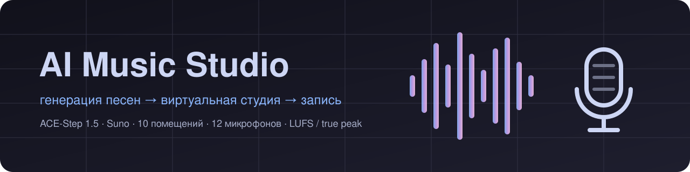
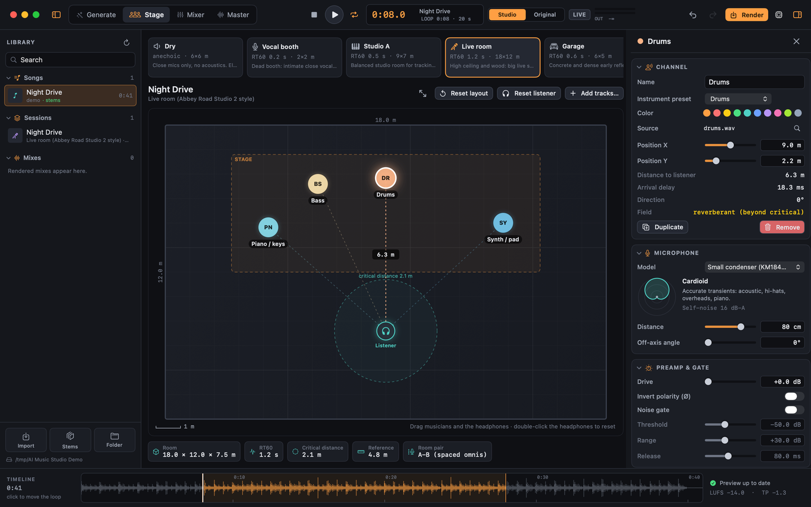
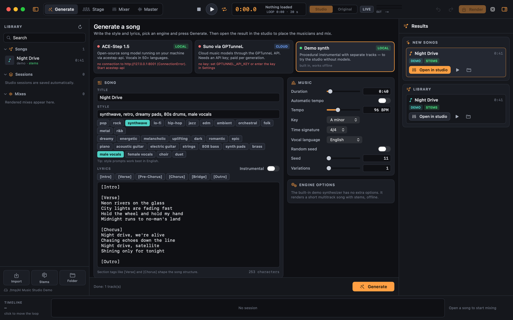
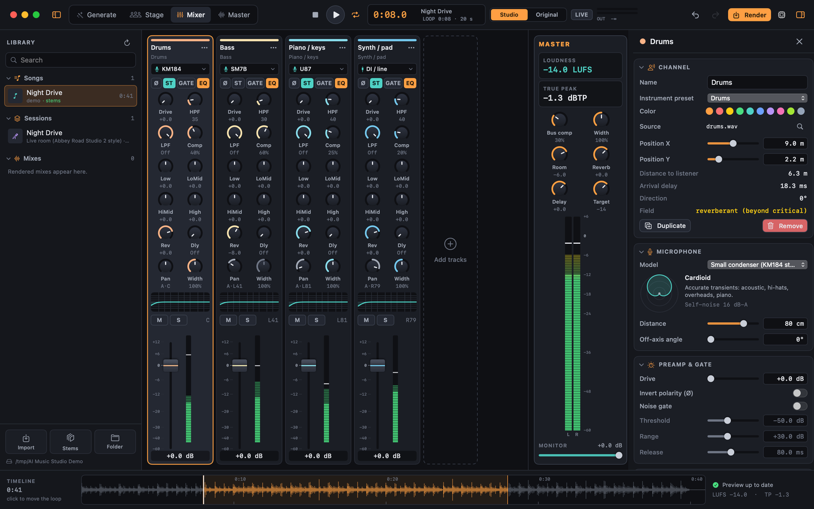
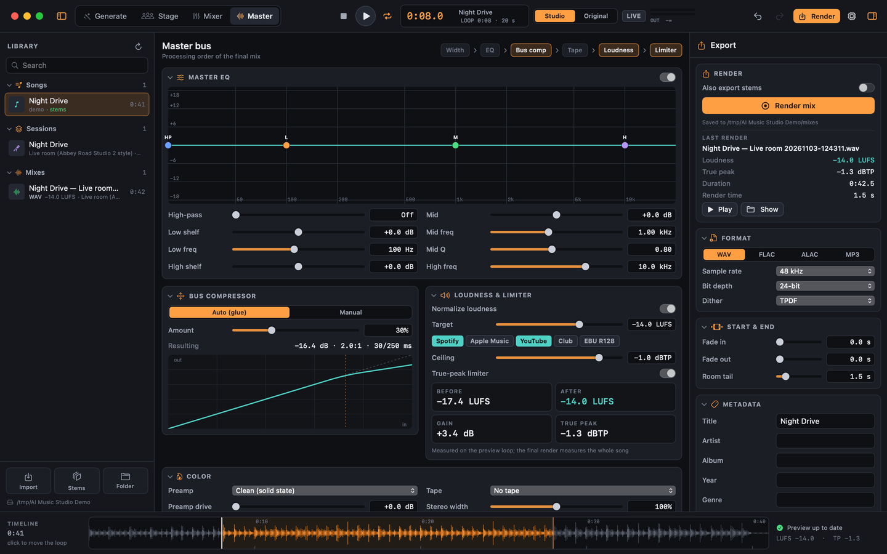
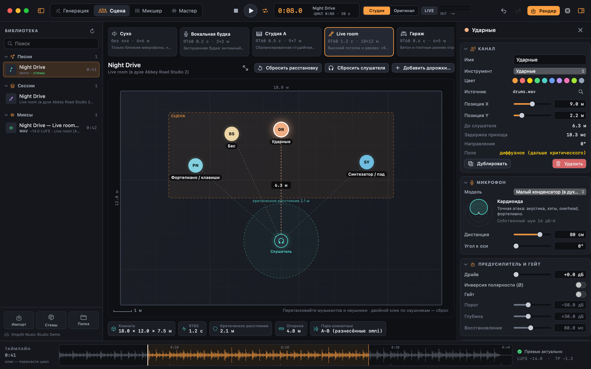
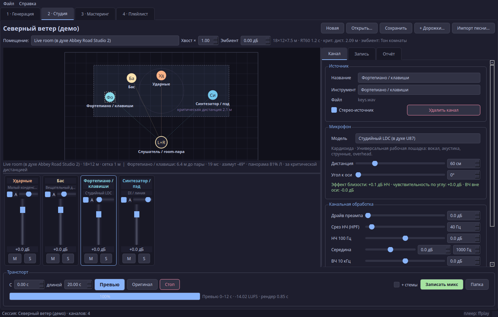

<p align="center">
  
</p>

<p align="center">
  <a href="https://github.com/MRX7999/AI-Music-Studio/actions/workflows/ci.yml"></a>
  <a href="https://github.com/MRX7999/AI-Music-Studio/releases/latest"></a>
  
  
  
  <a href="LICENSE"></a>
</p>

<p align="center">
  <b>Generate a song, put the band on a stage, pick the room and the microphones, and record it the way a real studio would.</b><br>
  English · <a href="README.ru.md">Русский</a>
</p>

<p align="center">
  
</p>

AI Music Studio is a native macOS app that joins AI song generation with a virtual recording studio. A song is split into tracks (vocals, drums, bass, keys…), every track becomes a musician on a stage, and the recording engine models the room, the microphones, the console, tape and mastering down to the target loudness. The interface is SwiftUI; the audio engine is Python (NumPy/SciPy) and runs next to the app as a local process, so nothing leaves your Mac unless you choose a cloud generator.

## Download

1. Get `AI-Music-Studio-1.1.0-macOS-arm64.zip` from the [latest release](https://github.com/MRX7999/AI-Music-Studio/releases/latest), unzip it and move **AI Music Studio.app** to Applications.
2. The app is signed ad hoc, not notarized, so the first launch needs one of these:
   - right-click the app → **Open** → **Open**, or
   - `xattr -dr com.apple.quarantine "/Applications/AI Music Studio.app"`
3. On first launch the app looks for Python 3.10–3.12 with `numpy`, `scipy`, `soundfile` and `requests` (pyenv, Homebrew, python.org, a project `.venv`). If none is found, **Set Up Automatically** creates a private venv in `~/Library/Application Support/AI Music Studio/venv` and installs the pinned [`requirements-engine.txt`](requirements-engine.txt); this needs internet once. You can also point the app at any interpreter with **Choose Python…**.

Requirements: macOS 14 Sonoma or newer, Apple Silicon (Intel Macs can build from source), Python 3.10–3.12, optional `ffmpeg` for ALAC/MP3 export (`brew install ffmpeg`).

## Features

| Area | What you get |
|---|---|
| Generate | ACE-Step 1.5 locally (recommended), Suno through GPTunneL Creative Lab (cloud), or the offline demo synth. Title, style with one-click tags, lyrics editor with `[Verse]`/`[Chorus]` section chips, instrumental switch, duration, BPM or auto, key, time signature, vocal language, seed, number of variations, model picker and every engine-specific option read from the engine's schema. GPTunneL shows the price before you start. |
| Stage | Ten rooms from a vocal booth to a stadium. A top-down plan to scale: drag musicians and the listener, see the critical distance and the room pair, zoom into the stage of big rooms, resize the room. |
| Microphones | Twelve microphone models with frequency response, polar pattern, proximity effect and self-noise; distance and off-axis angle per channel. |
| Mixer | A console strip per musician: mic, gain, pan that follows the stage or is set by hand, reverb and delay sends, mute and solo, fader with meters, plus a master strip with loudness and true-peak readouts. |
| Channel inspector | Preamp drive and gate, HPF/LPF and a four-band parametric EQ with a draggable curve, compressor (auto or manual: threshold, ratio, attack, release, knee, make-up) with a transfer curve, stereo width, output. |
| Recording | 44.1/48/96 kHz, 16/24/32-bit, preamps (clean, tube, transformer, opto), A-B, X-Y, ORTF, NOS or Blumlein room pair with height, spacing and time alignment, reverb pre-delay, return and tail, a delay bus (time, feedback, high cut, ping-pong), room ambience. |
| Master | Bus EQ, bus compressor (glue or manual), tape/cassette/vinyl, stereo width, ITU-R BS.1770-4 loudness normalization with presets (Spotify, Apple Music, YouTube, club, EBU R128), 4× oversampled true-peak limiter, fades, TPDF dither. |
| Export | WAV, FLAC, ALAC, MP3 with title/artist/album/genre/year tags and cover art; processed stems on request; loudness report after every render. |
| Listening | Loop preview rendered in the background from any point of the song, A/B between the original and the studio mix, live re-render after every change, level meters per channel. |
| Library | Songs, sessions and renders of the project folder with search; open a song as a fresh session, listen, reveal in Finder; import any audio file and split it into stems (built-in HPSS or Demucs). |
| Workflow | Undo/redo for every change, autosave, sessions as `session.studio.json` with relative paths, English and Russian interface (switch in Settings, engine texts follow). |
| Settings | Language, project folder, preview length, live preview, autosave, monitor volume, stem method; ACE-Step URL and key, GPTunneL key stored in the macOS Keychain; Python interpreter, engine folder, dependency status and engine restart. |

## Screenshots

| Generate | Mixer |
|---|---|
|  |  |
| **Master** | **Russian interface** |
|  |  |

## How it works

```text
SwiftUI app (macos/)                         Python engine (studio/)
┌──────────────────────────────┐  JSON lines  ┌──────────────────────────────────────────┐
│ Generate · Stage · Mixer ·    │ ───────────► │ engine_server.py                          │
│ Master · Library · Settings   │ ◄─────────── │  generators/  acestep · gptunnel · demo   │
│ AVAudioEngine playback,       │  stdin/stdout│  stems.py     HPSS · Demucs               │
│ meters, waveform, Keychain    │              │  render.py    rooms, mics, console, master│
└──────────────────────────────┘              └──────────────────────────────────────────┘
```

The app starts the engine as a child process and talks to it with one JSON object per line: requests carry an id, long jobs (generation, rendering, stem separation) stream progress events and can be cancelled. API keys live in the macOS Keychain and reach the engine only over this pipe (`config.set`); they are never written to sessions or settings files.

Signal chain of a channel and of the master bus (`studio/render.py`):

```text
stem → microphone (response, pattern, proximity, noise) → preamp → gate → HPF/LPF/EQ → compressor → width → fader
     ├─► close mic: pan from the stage position (or manual)      → dry bus
     ├─► room pair: direct sound + early reflections of the room → room bus
     ├─► reverb send: diffuse tail of the room (RT60, pre-delay) → reverb bus
     └─► delay send: delay with feedback, high cut, ping-pong    → delay bus
master: dry + room + reverb + delay + ambience → width → EQ → bus compressor → tape
        → LUFS normalization + true-peak limiter → fades → dither → file
```

The position of a musician relative to the listener sets the delay, distance attenuation, air absorption, pan and the direct-to-reverberant ratio. Early reflections use the image-source method for the room dimensions; the tail is a diffuse reverb with the room's RT60.

## Generation engines

### ACE-Step 1.5, local (recommended)

An open model under the MIT license that runs locally on Mac (MPS), CUDA, ROCm and CPU, generates from 10 seconds to 10 minutes and supports lyrics in 50+ languages ([ACE-Step 1.5](https://github.com/ace-step/ACE-Step-1.5)). The app talks to its REST API, which listens on port 8001 by default ([ACE-Step 1.5](https://github.com/ace-step/ACE-Step-1.5)).

```bash
curl -LsSf https://astral.sh/uv/install.sh | sh
git clone https://github.com/ACE-Step/ACE-Step-1.5.git
cd ACE-Step-1.5 && uv sync
uv run acestep-api            # server on :8001
```

In the app choose **ACE-Step 1.5** on the Generate page; its card shows the connection status, and the server address and key are in **Settings → Generators**. Details are in [docs/ACE_STEP.md](docs/ACE_STEP.md) and in the [ACE-Step API reference](https://github.com/ace-step/ACE-Step-1.5/blob/main/docs/en/API.md).

### Suno through GPTunneL, cloud (fallback)

A paid option that needs no local GPU. The app uses [Creative Lab API v2](https://docs.gptunnel.ru/creative-lab/create-task/): a task is created with `POST /api/v2/media/tasks` and polled until it is done; Suno returns two variants with cover art and lyrics ([GPTunneL: get task](https://docs.gptunnel.ru/creative-lab/get-task/)). The price is shown before you start through the [price endpoint](https://docs.gptunnel.ru/creative-lab/price/), and the model list comes from the [models endpoint](https://docs.gptunnel.ru/creative-lab/models/).

Paste the key in **Settings → Generators** (it goes to the macOS Keychain) or set `GPTUNNEL_API_KEY`.

### Demo, offline

A procedural synth without AI and without network: drums, bass, keys and a melody at the chosen BPM and key, delivered as stems. It lets you try the whole studio right after installing, and the tests use it.

## Rooms

| ID | Room | Size | RT60 |
|---|---|---|---|
| `dry` | Dry (no room) | 6×6×3 m | 0 s |
| `booth` | Vocal booth | 2.2×2×2.4 m | 0.18 s |
| `studio_a` | Studio A, mid-size room | 9×7×3.6 m | 0.45 s |
| `live_room` | Live room (in the spirit of Abbey Road Studio 2) | 18×12×7.5 m | 1.2 s |
| `garage` | Garage / rehearsal space | 6×5×2.7 m | 0.55 s |
| `club` | Club for 300 people | 16×14×5 m | 0.9 s |
| `concert_hall` | Concert hall | 40×30×16 m | 2.0 s |
| `cathedral` | Cathedral | 28×70×30 m | 4.5 s |
| `arena` | Arena / stadium | 140×110×35 m | 2.6 s |
| `open_air` | Open air / festival | 80×80×40 m | 0.35 s |

## Microphones

| ID | Model | Pattern |
|---|---|---|
| `ldc_tube` | Tube LDC (U47 style) | cardioid |
| `ldc_studio` | Studio LDC (U87 style) | cardioid |
| `ldc_bright` | Bright LDC (C414 / AT4050 style) | cardioid |
| `sdc_pencil` | Small-diaphragm condenser (KM184 style) | cardioid |
| `dyn_vocal` | Dynamic vocal (SM58 style) | cardioid |
| `dyn_inst` | Dynamic instrument (SM57 style) | cardioid |
| `dyn_broadcast` | Broadcast dynamic (SM7B style) | cardioid |
| `dyn_kick` | Kick drum mic (D112 / Beta 52 style) | supercardioid |
| `ribbon` | Ribbon (R-121 / Coles 4038 style) | figure-8 |
| `omni_measure` | Measurement omni (DPA 4006 style) | omni |
| `lofi_phone` | Lo-fi / telephone | omni |
| `di` | DI / line (no microphone) | — |

The models are generic curves of microphone classes, not measured profiles of specific units; brand names only hint at the character. Thirteen instrument types (vocals, backing vocals, drums, kick, bass, electric and acoustic guitar, keys, synth, strings, brass, other, full mix) come with starting presets for mic, distance and processing.

## Keyboard shortcuts

| Keys | Action |
|---|---|
| `⌘1` `⌘2` `⌘3` `⌘4` | Generate · Stage · Mixer · Master |
| `Space` | play / pause the preview |
| `⌘.` | stop |
| `⌘↩` | generate |
| `⌘R` | render the mix |
| `⌘O` | import a song |
| `⇧⌘N` | new session from stems |
| `⌘S` | save the session |
| `⌘Z` / `⇧⌘Z` | undo / redo |
| `⌥⌘L` / `⌥⌘I` | show or hide the library / inspector |
| `⌘,` | settings |

## Build from source

```bash
git clone https://github.com/MRX7999/AI-Music-Studio.git
cd AI-Music-Studio
python3 -m venv .venv && source .venv/bin/activate
pip install -r requirements-engine.txt
macos/build_app.sh                 # → dist/AI Music Studio.app and a zip
open "dist/AI Music Studio.app"
```

Xcode 15+ or only the Command Line Tools are enough. With the Command Line Tools alone the script builds against a macOS 26.x/15.x SDK: with the macOS 27 SDK of the Command Line Tools the build fails on SwiftUI's `@State`, which is a macro there. For development, `swift run` from `macos/` starts the app straight from the checkout and finds the engine in the repository (set `SDKROOT` the same way when you only have the Command Line Tools).

The executable also has headless modes that CI and the release process use:

```bash
APP="dist/AI Music Studio.app/Contents/MacOS/AIMusicStudio"
"$APP" --selftest --python .venv/bin/python     # engine workflow, DSP and localization checks, exit code 0/1
"$APP" --screenshots docs/screenshots           # renders the README screenshots from a demo session
"$APP" --smoke 8 /tmp/ams-smoke.json            # opens the window, writes a JSON report, quits
"$APP" --project ~/Music/Demo                   # uses this project folder for one launch, settings stay as they are
```

## Python app and CLI

The cross-platform PyQt5 studio from 1.0 and the command line are still here and use the same engine.

<details>
<summary>PyQt interface (Russian)</summary>



</details>

```bash
pip install -r requirements.txt          # adds PyQt5 and the playlist tools
python studio_app.py                     # PyQt interface (Russian)

python studio_cli.py generate --engine demo --title "North Wind" --duration 60 --bpm 104 --key "A minor" --out out
python studio_cli.py session "out/North Wind/North Wind.wav" --scene concert_hall -o out/session
python studio_cli.py render out/session/session.studio.json --format flac --stems
python studio_cli.py list scenes | mics | instruments
```

`generate` also takes `--style`, `--lyrics`/`--lyrics-file`, `--instrumental`, `--lang`, `--seed`, `--variations`, `--model` and `--extra '{"inference_steps": 8}'` for engine-specific parameters. Optional heavy models (Demucs, and AudioSR/Whisper/librosa for the legacy mastering tab) are in `requirements-ml.txt`.

## Environment variables

Settings in the app cover everything below; the variables are for the CLI, the PyQt app and CI. Copy `.env.example` to `.env`; `run_studio.command` reads it, in a terminal use `set -a; source .env; set +a`.

| Variable | Purpose |
|---|---|
| `ACESTEP_API_URL` | ACE-Step server, default `http://127.0.0.1:8001` |
| `ACESTEP_API_KEY` | key, if the server runs with authentication |
| `GPTUNNEL_API_KEY` | GPTunneL key for Suno |
| `GPTUNNEL_PLAYLIST_URL` | playlist link for the PyQt "Playlist" tab |
| `GPTUNNEL_ALBUM_NAME` | album name in the tags of downloaded tracks |
| `AMS_PYTHON` | interpreter for the macOS app engine (same as Settings → Engine) |
| `AMS_ENGINE_DIR` | engine folder for the macOS app, if not the bundled one |

## Tests

```bash
pip install -r requirements-dev.txt
QT_QPA_PLATFORM=offscreen pytest -q
```

64 Python tests cover DSP and loudness, rendering in all ten rooms (LUFS within ±1.5, true peak ≤ −0.5 dBTP), pan from position, mute/solo, sessions, the engine server protocol, the ACE-Step and GPTunneL protocols against local mock servers, and the PyQt workflow from generation to recording. The macOS job builds the app bundle and runs `--selftest`, which drives the real engine through generate → session → scene → channel edit → undo → preview → meters → final render → save → library → Russian localization. CI runs both on every push.

## Project layout

```text
AI-Music-Studio/
├── macos/                     # native app (SwiftUI, Swift Package)
│   ├── Package.swift
│   ├── build_app.sh           # .app bundle + zip
│   ├── Resources/             # app icon
│   └── Sources/AIMusicStudio/ # views, store, engine client, player, DSP previews
├── studio/
│   ├── engine_server.py       # JSON-lines engine for the macOS app
│   ├── dsp.py  loudness.py  mics.py  scenes.py  session.py  render.py  stems.py  audio_io.py
│   ├── library.py  i18n.py    # project folder scan, English/Russian texts
│   ├── generators/            # acestep, gptunnel, demo
│   └── ui/                    # PyQt5 interface
├── studio_app.py  studio_cli.py
├── full_pipeline.py  gui_pipeline.py  humanize.py  download_playlist.py   # tools from the original project
├── tests/  scripts/  docs/
└── requirements*.txt
```

## Limitations

- This is modeling, not ray tracing: reflections are image sources in a rectangular room, the tail is a statistical reverb.
- The built-in HPSS splits a mixed song into four pseudo-stems (bass, percussion, center, sides); clean vocal separation needs Demucs (`requirements-ml.txt`).
- ACE-Step is installed and started separately; Suno through GPTunneL is paid and needs a key.
- The release build is for Apple Silicon and not notarized; Intel Macs can build it from source with `macos/build_app.sh`.
- When you publish generated music, follow the model license and the platform rules, including AI-content disclosure requirements.

## License

[MIT](LICENSE). ACE-Step, Suno, GPTunneL, Demucs, AudioSR and Whisper are covered by their own licenses and terms.
