<p align="center">
  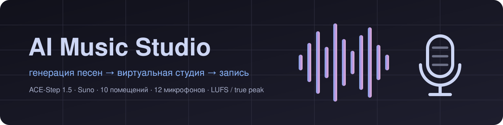
</p>

<p align="center">
  <a href="https://github.com/MRX7999/AI-Music-Studio/actions/workflows/ci.yml"></a>
  <a href="https://github.com/MRX7999/AI-Music-Studio/releases/latest"></a>
  
  
  
  
  <a href="LICENSE"></a>
</p>

<p align="center">
  <b>Сгенерируйте песню, расставьте музыкантов на сцене, запишите её как в настоящей студии и выпустите релиз.</b><br>
  <a href="README.md">English</a> · Русский
</p>

<p align="center">
  <a href="https://github.com/MRX7999/AI-Music-Studio/releases/latest"></a>
</p>

<p align="center">
  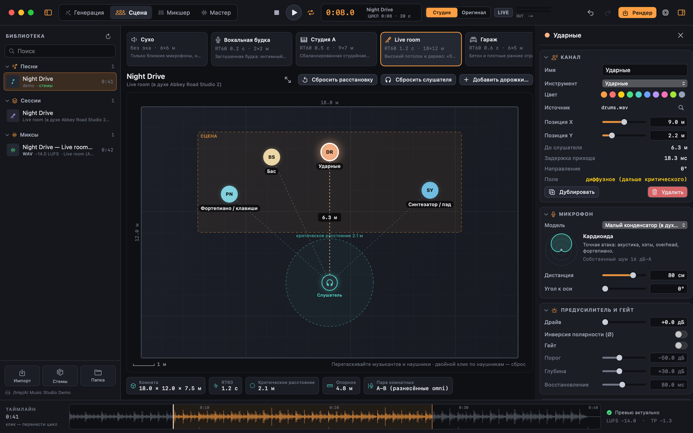
</p>

## От промпта до релиза

<p align="center">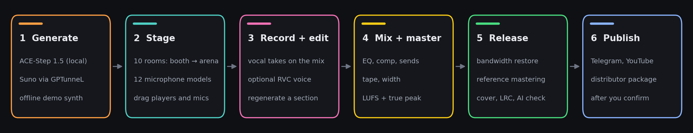</p>

## Генерация

ACE-Step 1.5 на вашем Mac, Suno через GPTunneL или офлайн-демосинтезатор. Все параметры движка вынесены в форму, цена платного запуска видна заранее.

<p align="center">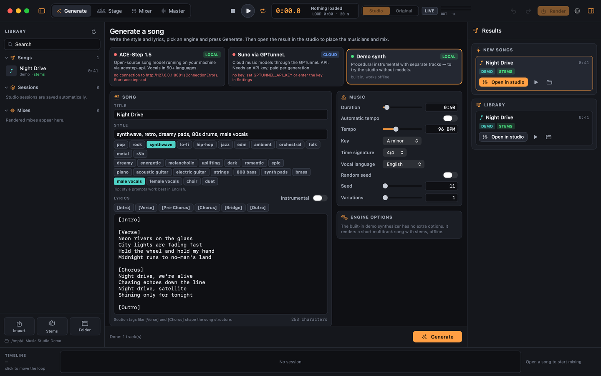</p>

## Помещения и микрофоны

Десять помещений от вокальной будки до арены, двенадцать моделей микрофонов. Затухание каждого зала зависит от частоты, как в реальном пространстве.

<p align="center">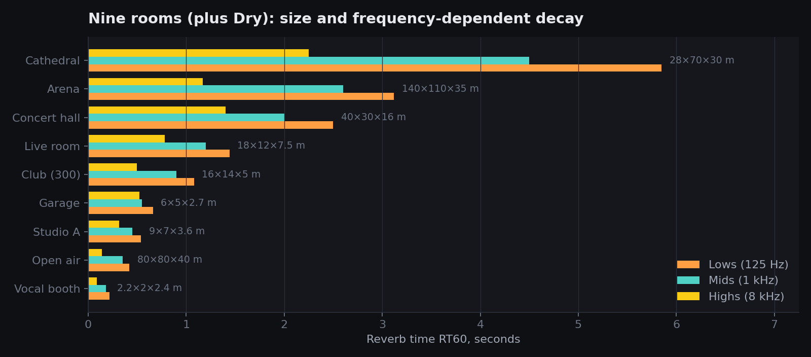</p>

## Сведение и мастеринг

<table>
  <tr>
    <td width="50%">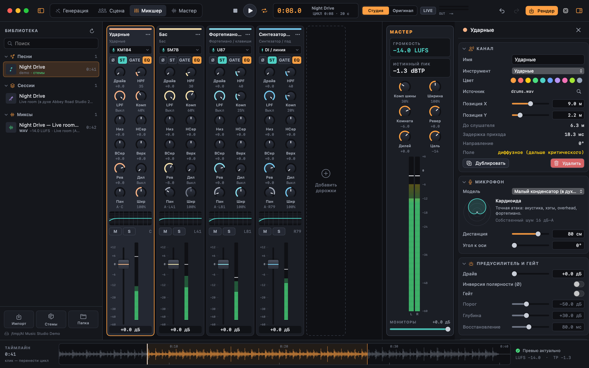</td>
    <td width="50%">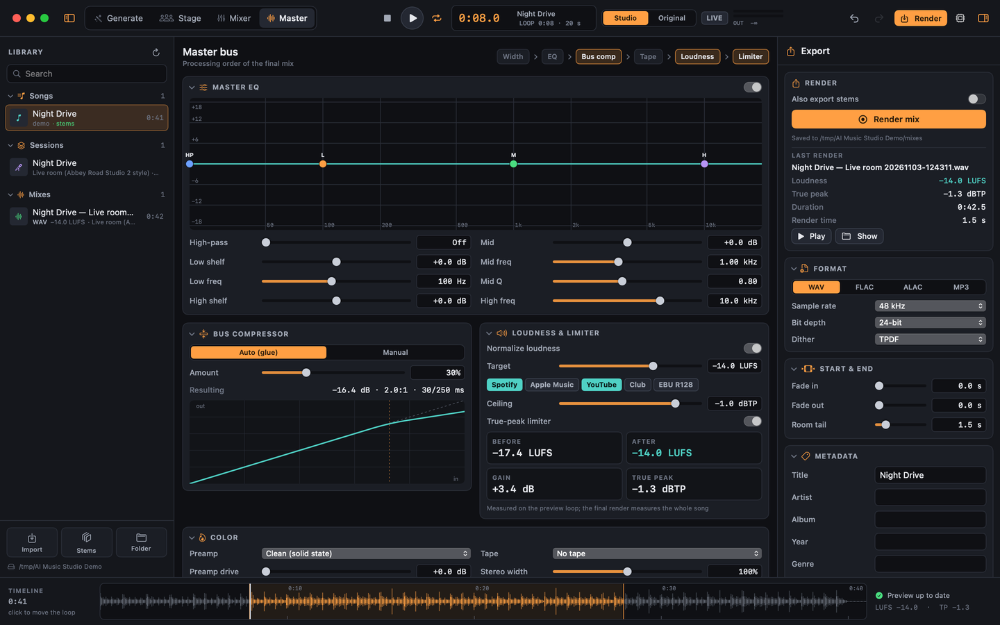</td>
  </tr>
  <tr>
    <td align="center">Линейка на каждого музыканта, посылы, индикаторы</td>
    <td align="center">EQ шины, glue, лента, громкость по BS.1770, лимитер true peak</td>
  </tr>
</table>

## Перегенерация любой части

Выделите участок на волне или нажмите на чип секции, задайте новый промпт или текст, и изменится только этот фрагмент. Вне выделения песня остаётся бит в бит.

<p align="center">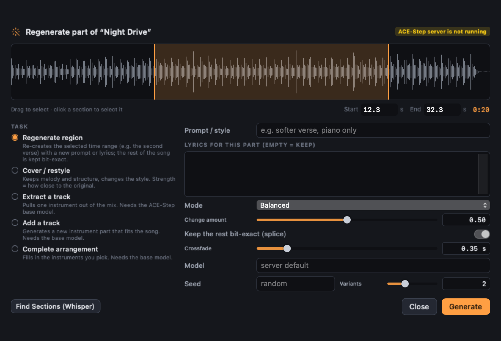</p>

## Релиз

Одна страница от микса до готового релиза: восстановление полосы, мастеринг по референсу, обложка, синхронный текст, гуманизация (твой модуль из 12 шагов), проверка на ИИ, пакет для дистрибьютора, публикация.

<p align="center">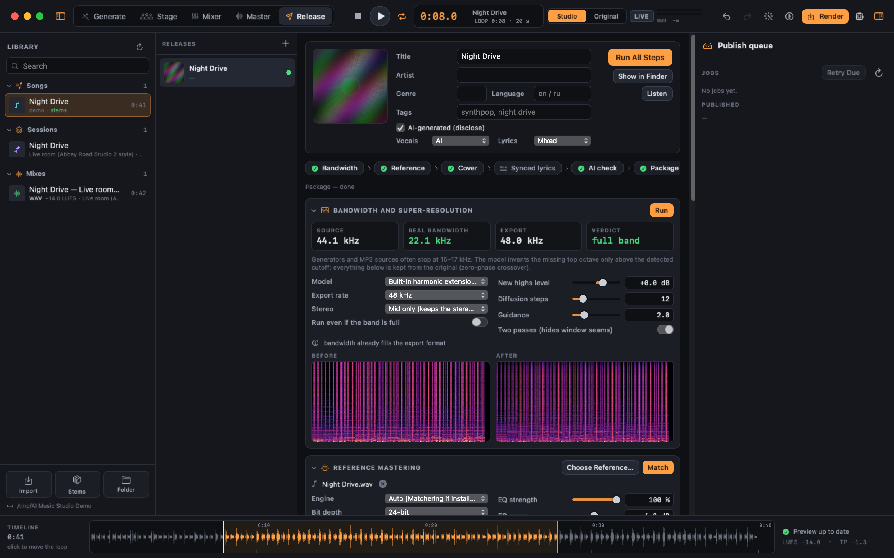</p>

<p align="center">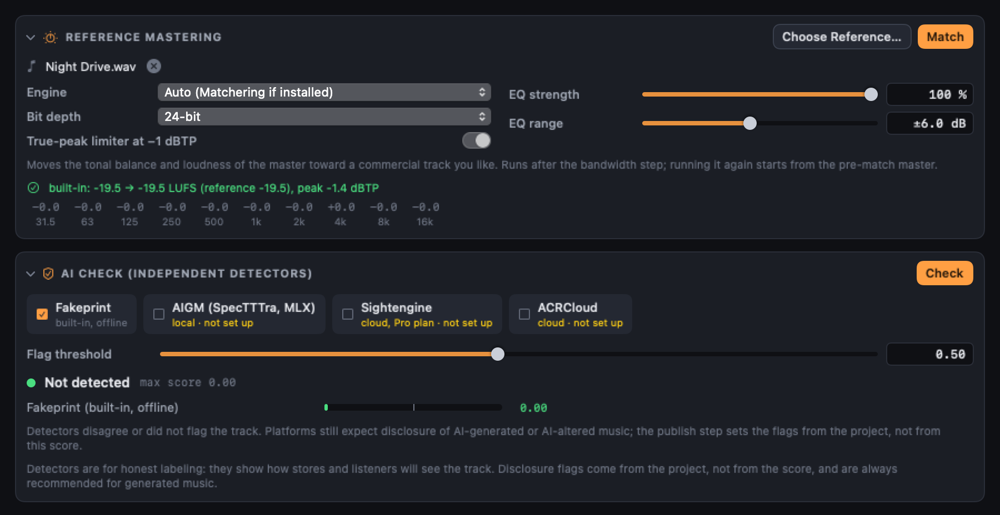</p>

### Восстановление полосы, замер

Копия демопесни, обрезанная на 11 кГц как MP3, после встроенного расширения (без установленной модели). Если установлены FlashSR (MLX) или AudioSR, работают они.

<p align="center">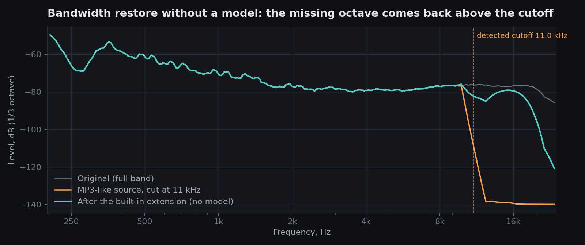</p>

### Мастеринг по референсу, замер

Та же песня, подогнанная под другую, отмастеренную до −11 LUFS: линейно-фазовый EQ к спектру референса, затем его громкость.

<p align="center">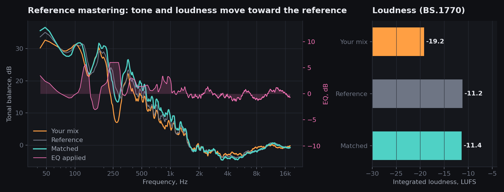</p>

<sub>Оба графика считает сам движок: <code>python scripts/readme_charts.py</code>.</sub>

## Локальные модели и публикация

<table>
  <tr>
    <td width="50%">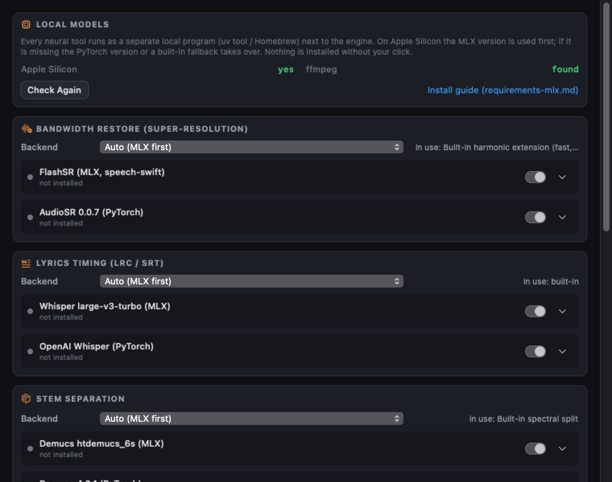</td>
    <td width="50%">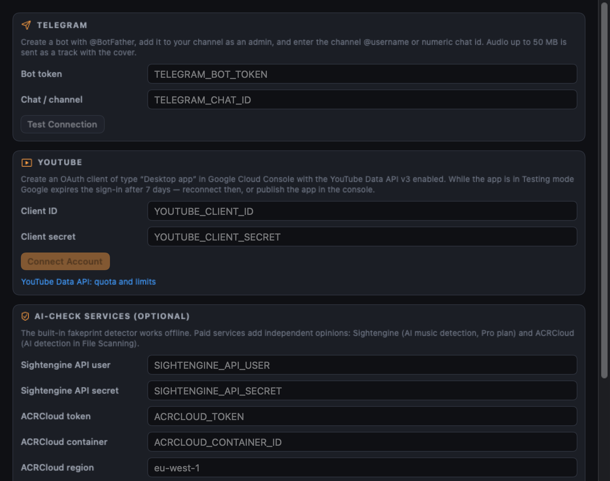</td>
  </tr>
  <tr>
    <td align="center">Сначала MLX, затем PyTorch, затем встроенный вариант. Ничего не ставится без вашего клика</td>
    <td align="center">Telegram, YouTube, сервисы проверки на ИИ. Ключи хранятся в Keychain</td>
  </tr>
</table>

## Английский интерфейс

<table>
  <tr>
    <td width="50%">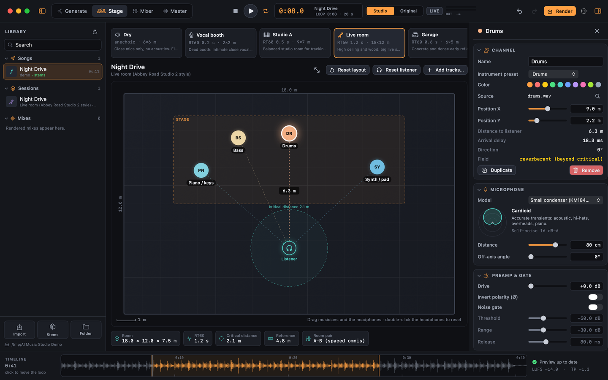</td>
    <td width="50%">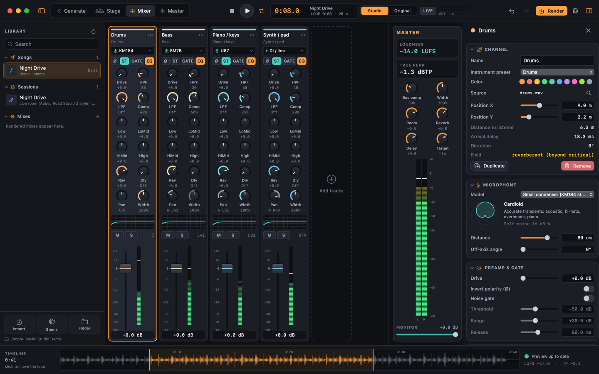</td>
  </tr>
</table>

## Как это устроено

<p align="center">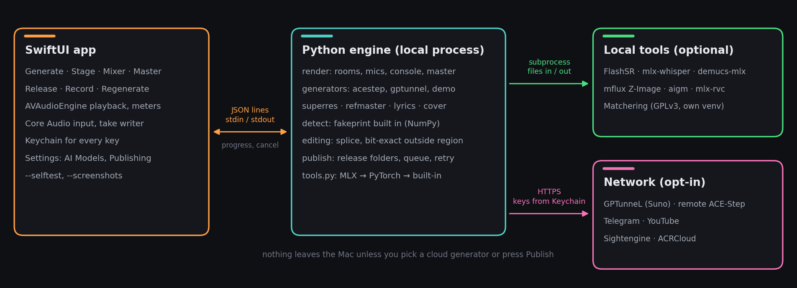</p>

## Быстрый старт

1. Скачайте `AI-Music-Studio-1.3.0-macOS-arm64.zip` со [страницы последнего релиза](https://github.com/MRX7999/AI-Music-Studio/releases/latest), распакуйте и перенесите **AI Music Studio.app** в «Программы».
2. Приложение подписано ad hoc и не нотаризовано, поэтому при первом запуске нужен один из вариантов:
   - правый клик по приложению → **Открыть** → **Открыть**, или
   - `xattr -dr com.apple.quarantine "/Applications/AI Music Studio.app"`
3. При первом запуске приложение ищет Python 3.10–3.12 с `numpy`, `scipy`, `soundfile` и `requests` (pyenv, Homebrew, python.org, `.venv` проекта). Если подходящего нет, кнопка **Настроить автоматически** создаёт собственное окружение в `~/Library/Application Support/AI Music Studio/venv` и ставит закреплённые версии из [`requirements-engine.txt`](requirements-engine.txt); для этого один раз нужен интернет. Любой другой интерпретатор можно указать кнопкой **Выбрать Python…**.

Требования: macOS 14 Sonoma или новее, Apple Silicon (на Intel можно собрать из исходников), Python 3.10–3.12, по желанию `ffmpeg` для экспорта в ALAC/MP3 (`brew install ffmpeg`).

<details>
<summary><b>Сборка из исходников</b></summary>

```bash
git clone https://github.com/MRX7999/AI-Music-Studio.git
cd AI-Music-Studio
python3 -m venv .venv && source .venv/bin/activate
pip install -r requirements-engine.txt
macos/build_app.sh                 # → dist/AI Music Studio.app и zip
open "dist/AI Music Studio.app"
```

Хватит Xcode 15+ или одних Command Line Tools. С одними Command Line Tools скрипт собирает с SDK macOS 26.x/15.x: с SDK macOS 27 из Command Line Tools сборка падает на `@State` из SwiftUI, который там стал макросом. Для разработки `swift run` из папки `macos/` запускает приложение прямо из репозитория, движок находится автоматически (при одних Command Line Tools так же задайте `SDKROOT`).

У исполняемого файла есть режимы без окна, их используют CI и выпуск релиза:

```bash
APP="dist/AI Music Studio.app/Contents/MacOS/AIMusicStudio"
"$APP" --selftest --python .venv/bin/python     # проверки движка, DSP и локализации, код выхода 0/1
"$APP" --screenshots docs/screenshots           # скриншоты для README на демо-сессии
"$APP" --smoke 8 /tmp/ams-smoke.json            # открывает окно, пишет JSON-отчёт и выходит
"$APP" --project ~/Music/Demo                   # папка проекта только на этот запуск, настройки не меняются
```

</details>

## Справка

<details>
<summary><b>Все возможности</b></summary>

| Раздел | Что внутри |
|---|---|
| Генерация | ACE-Step 1.5 локально (рекомендуется), Suno через GPTunneL Creative Lab (облако) или офлайн-демосинтезатор. Название, стиль с тегами в один клик, редактор текста с кнопками разделов `[Verse]`/`[Chorus]`, режим «без вокала», длительность, BPM или авто, тональность, размер, язык вокала, seed, число вариантов, выбор модели и все параметры конкретного движка, которые приложение читает из его схемы. Для GPTunneL цена видна до запуска. |
| Сцена | Десять помещений от вокальной будки до стадиона. План сверху в масштабе: перетаскивайте музыкантов и слушателя, смотрите радиус гулкости и пару комнатных микрофонов, приближайте сцену больших залов, меняйте размер помещения. |
| Микрофоны | Двенадцать моделей с АЧХ, диаграммой направленности, эффектом близости и собственным шумом; расстояние и угол к оси для каждого канала. |
| Микшер | Канальная линейка на каждого музыканта: микрофон, усиление, панорама от положения на сцене или вручную, посылы на реверберацию и дилей, mute и solo, фейдер с индикаторами, плюс мастер-линейка с громкостью и true peak. |
| Инспектор канала | Перегруз преампа и гейт, HPF/LPF и четырёхполосный параметрический эквалайзер с перетаскиваемой кривой, компрессор (авто или вручную: порог, ratio, атака, восстановление, колено, make-up) с передаточной кривой, стереоширина, выход. |
| Запись | 44,1/48/96 кГц, 16/24/32 бит, преампы (чистый, ламповый, трансформаторный, оптический), комнатная пара A-B, X-Y, ORTF, NOS или Blumlein с высотой, базой и выравниванием по времени, пред-задержка, возврат и хвост реверберации, шина дилея (время, обратная связь, срез ВЧ, пинг-понг), фон помещения. |
| Мастер | Эквалайзер шины, компрессор шины (glue или вручную), лента/кассета/винил, стереоширина, нормализация громкости по ITU-R BS.1770-4 с пресетами (Spotify, Apple Music, YouTube, клуб, EBU R128), лимитер true peak с 4× передискретизацией, фейды, TPDF-дизеринг. |
| Экспорт | WAV, FLAC, ALAC, MP3 с тегами (название, исполнитель, альбом, жанр, год) и обложкой; обработанные стемы по запросу; отчёт о громкости после каждого рендера. |
| Прослушивание | Фоновый рендер превью-петли с любого места песни, A/B между оригиналом и студийным миксом, живой перерендер после каждого изменения, индикаторы уровня по каналам. |
| Библиотека | Песни, сессии и рендеры папки проекта с поиском; открыть песню как новую сессию, прослушать, показать в Finder; импорт любого аудиофайла с разделением на стемы (встроенный HPSS или Demucs). |
| Работа | Undo/redo для каждого изменения, автосохранение, сессии в `session.studio.json` с относительными путями, интерфейс на английском и русском (переключается в настройках, тексты движка следуют за ним). |
| Настройки | Язык, папка проекта, длина превью, живое превью, автосохранение, громкость мониторинга, способ разделения на стемы; адрес и ключ ACE-Step, ключ GPTunneL в связке ключей macOS; интерпретатор Python, папка движка, состояние зависимостей и перезапуск движка. |

| Раздел | Что внутри |
|---|---|
| Перегенерация части | Выберите любую песню в библиотеке (ACE-Step, Suno через GPTunneL или импортированный файл), выделите отрезок на волне или нажмите метку раздела (`[Verse 2]`, `[Chorus]`) и перегенерируйте только его с новым промптом или текстом. ACE-Step заново декодирует всю песню, поэтому приложение вклеивает результат обратно с равномощными кроссфейдами: всё вне фрагмента остаётся бит-в-бит. Кавер/смена стиля с регулятором близости, извлечение инструмента, добавление дорожки и дописывание аранжировки (последние три требуют base-модель ACE-Step). |
| Запись вокала | Запись дубля прямо в открытую сессию: выбор входа и канала, индикатор уровня с пиком и предупреждением о перегрузе, мониторинг в наушниках, отсчёт кликом, песня играет фонограммой с любого места. Дубль ставится на таймлайн с вычетом измеренной задержки входа и выхода (плюс ручной сдвиг), сохраняется в `takes/vocals-take-N.wav` и добавляется вокальным каналом. По желанию — смена тембра локальной моделью RVC (mlx-rvc). |
| Страница «Релиз» | Релиз — папка из песни или рендера с пометкой об ИИ (что сгенерировано: музыка, вокал, текст, инструменты) и шагами, которые запускаются по одному или все сразу: восстановление спектра до 48 кГц, мастеринг по референсу, обложка 3000×3000, тайминг текста в LRC/SRT, гуманизация (12 шагов: питч-микроварп, джиттер тайминга, лентовая сатурация, воздух, EQ-рандомизация, фазовый дизер, микрореверб), проверка на ИИ-генерацию, пакет для дистрибьютора. |
| Восстановление спектра | В MP3 и генерациях на 32 кГц всё выше 11–16 кГц срезано. Спектр показывает срез; FlashSR (MLX) или AudioSR достраивают верх, без модели встроенный гармонический эксайтер достраивает недостающую октаву из октавы под срезом и подгоняет её уровень под спектр чуть ниже среза. Ниже среза остаётся оригинал. |
| Обложка | Z-Image Turbo через mflux (MLX) по промпту из названия, жанра и настроения или встроенная генеративная графика без модели; JPEG 3000×3000 и миниатюра. |
| Тайминг текста | Whisper (сначала mlx-whisper, запасной — openai-whisper) выравнивает ваш текст по словам и пишет `.lrc` и `.srt`; LRC открывается в редакторе, время можно поправить вручную. |
| Проверка на ИИ | Перед публикацией мастер проходит независимые детекторы: оценка по каждому и рекомендация о пометке. Подробнее — Проверка на ИИ-генерацию. |
| Публикация | Канал в Telegram (аудио с обложкой и подписью), YouTube (видео из обложки и аудио, `containsSyntheticMedia` для ИИ-песен; приватно, по ссылке, публично или по расписанию) и папка для дистрибьютора под Spotify, Apple Music, Яндекс Музыку. Ничего не отправляется, пока вы не подтвердите сводку; неудачные загрузки уходят в очередь с повтором. |
| Мастеринг по референсу | Выбираешь коммерческий трек-образец: Matchering 2.0.6 отдельным процессом (GPLv3) или встроенный подгонщик (разница усреднённых спектров как линейно-фазовый EQ ±1–12 дБ с регулируемой силой, затем громкость референса по BS.1770 и лимитер true peak −1 dBTP). |
| Настройки | **AI-модели**: статус, лицензия и команда установки каждого локального инструмента, бэкенд для каждой функции (Авто = сначала MLX), свой путь и аргументы. **Публикация**: Telegram, вход в YouTube, ключи Sightengine и ACRCloud в связке ключей. |

</details>

<details>
<summary><b>Локальные модели, сначала MLX</b></summary>

Каждая нейросеть — отдельная программа рядом с движком и ставится только по вашему решению (закреплённые команды — в [requirements-mlx.md](requirements-mlx.md)). На Apple Silicon сначала берётся MLX-инструмент, затем PyTorch, затем встроенный вариант.

| Функция | MLX (Apple Silicon) | Запасной вариант |
|---|---|---|
| Восстановление спектра | [FlashSR в speech-swift](https://github.com/soniqo/speech-swift/blob/main/docs/models/flashsr.md) | AudioSR 0.0.7, встроенный |
| Тайминг текста | [mlx-whisper 0.4.3](https://pypi.org/project/mlx-whisper/) | openai-whisper 20250625 |
| Стемы | [demucs-mlx 1.6.1](https://pypi.org/project/demucs-mlx/) | Demucs 4.0.1, встроенный HPSS |
| Обложка | [mflux 0.24.0](https://github.com/filipstrand/mflux), Z-Image Turbo 4-bit | встроенная |
| Проверка на ИИ | [aigm-detector](https://github.com/shoegazerstella/ai-music-detector) (SpecTTTra) | встроенный fakeprint |
| Смена голоса | [mlx-rvc](https://github.com/lextoumbourou/mlx-rvc) | — |
| Перегенерация фрагмента | [ACE-Step 1.5](https://github.com/ace-step/ACE-Step-1.5), MLX-бэкенд | PyTorch-бэкенд ACE-Step |

Это не переписывание приложения: движок вызывает каждый инструмент через адаптер с фиксированным входом и выходом, новый бэкенд — одна запись в `studio/tools.py`.

Инструменты ищутся в `PATH`, `~/.local/bin` (uv, pipx), Homebrew, в Python самого движка и во всех версиях pyenv, venv (`~/.virtualenvs`, `~/.venv`) и окружениях conda/miniforge, так что `pip install openai-whisper` в Python из pyenv работает без настройки. Если выбранного в настройках инструмента нет, а другой для той же задачи установлен, приложение берёт его и пишет об этом. Модель Z-Image Turbo (5,9 ГБ) приложение скачивает само, с прогрессом, при первой обложке; недокачанные файлы прерванных загрузок перед этим удаляются.

</details>

<details>
<summary><b>Проверка на ИИ-генерацию</b></summary>

| Детектор | Где работает | Примечание |
|---|---|---|
| fakeprint, встроенный | офлайн, NumPy | [lofcz/ai-music-detector](https://github.com/lofcz/ai-music-detector) (MIT), метод из [arXiv:2506.19108](https://arxiv.org/abs/2506.19108); веса идут с приложением, результат совпадает с эталонной моделью на PyTorch с точностью 1e-6 |
| aigm-detector | офлайн, MLX | [shoegazerstella/ai-music-detector](https://github.com/shoegazerstella/ai-music-detector), ансамбль SpecTTTra, закреплённый коммит |
| Sightengine | облако, ваш ключ | [AI music detection](https://sightengine.com/docs/ai-generated-music-detection), на тарифе Pro ([цены](https://sightengine.com/pricing)) |
| ACRCloud | облако, ваш ключ | [AI-детекция в File Scanning](https://docs.acrcloud.com/reference/console-api/file-scanning/metadata/ai-detection) |

Детекторы расходятся между собой, и ни один не доказательство — это видно по [независимому сравнению 8 детекторов](https://dev.to/han_lou_493c3fecccc66c1f0/i-tested-8-ai-song-detectors-on-the-same-songs-heres-what-actually-works-4lpg). Приложение использует проверку, чтобы рекомендовать пометку, а не скрыть её: если песня сгенерирована, пометка об ИИ в релизе стоит всегда.

</details>

<details>
<summary><b>Ограничения публикации</b></summary>

- Боты Telegram отправляют аудио до 50 МБ ([Bot API](https://core.telegram.org/bots/api)), поэтому приложение отправляет MP3 320 кбит/с с тегами и обложкой.
- Загрузка на YouTube тратит квоту ([стоимость операций](https://developers.google.com/youtube/data/determine_quota_cost)); пометка ИИ — поле `status.containsSyntheticMedia` ([история изменений API](https://developers.google.com/youtube/data/revision_history)). У OAuth-клиента в режиме Testing вход истекает через 7 дней.
- Spotify, Apple Music и Яндекс Музыка принимают релизы только через дистрибьютора ([условия Яндекс Музыки](https://yandex.ru/support/music/ru/performers-and-copyright-holders/terms), [Apple Music](https://artists.apple.com/support/1108-get-your-next-release-on-apple-music)); в папке пакета — аудиофайл в выбранном формате (WAV 16/24/32-bit float, FLAC или ALAC 16/24 бит на 44,1–96 кГц либо MP3 128–320 кбит/с; по умолчанию WAV 44,1 кГц / 24 бит с дизерингом TPDF), обложка, текст, LRC, `metadata.json` с пометкой об ИИ, отчёт проверки и суммы SHA-256. Теги записываются в сам файл: название, исполнитель, альбом, жанр, дата релиза, композитор, автор текста, продюсер, лейбл, копирайт, ISRC, UPC, язык, пометка explicit, текст без меток разделов, обложка 3000 px и пометка об ИИ (ID3v2.3 в MP3 и WAV, LIST INFO в WAV, Vorbis comments и PICTURE во FLAC, атомы iTunes в ALAC). Поля заполняются в «Релиз» → «Пакет для дистрибьютора».

</details>

<details>
<summary><b>Движки генерации: ACE-Step, GPTunneL, демо</b></summary>

### ACE-Step 1.5, локально (рекомендуется)

Открытая модель под лицензией MIT: работает локально на Mac (MPS), CUDA, ROCm и CPU, генерирует от 10 секунд до 10 минут и поддерживает тексты на 50+ языках ([ACE-Step 1.5](https://github.com/ace-step/ACE-Step-1.5)). Приложение обращается к её REST API, который по умолчанию слушает порт 8001 ([ACE-Step 1.5](https://github.com/ace-step/ACE-Step-1.5)).

```bash
curl -LsSf https://astral.sh/uv/install.sh | sh
git clone https://github.com/ACE-Step/ACE-Step-1.5.git
cd ACE-Step-1.5 && uv sync
uv run acestep-api            # сервер на :8001
```

В приложении выберите **ACE-Step 1.5** на странице генерации; карточка движка показывает состояние подключения, адрес сервера и ключ задаются в **Настройки → Генераторы**. Подробности — в [docs/ACE_STEP.md](docs/ACE_STEP.md) и в [описании API ACE-Step](https://github.com/ace-step/ACE-Step-1.5/blob/main/docs/en/API.md).

### Suno через GPTunneL, облако (запасной вариант)

Платный вариант без локальной видеокарты. Приложение использует [Creative Lab API v2](https://docs.gptunnel.ru/creative-lab/create-task/): задача создаётся запросом `POST /api/v2/media/tasks` и опрашивается до готовности; Suno возвращает два варианта с обложкой и текстом ([GPTunneL: получение задачи](https://docs.gptunnel.ru/creative-lab/get-task/)). Цена показывается до запуска через [метод расчёта цены](https://docs.gptunnel.ru/creative-lab/price/), список моделей берётся из [метода моделей](https://docs.gptunnel.ru/creative-lab/models/).

Вставьте ключ в **Настройки → Генераторы** (он попадёт в связку ключей macOS) или задайте `GPTUNNEL_API_KEY`.

### Демо, офлайн

Процедурный синтезатор без нейросети и без сети: ударные, бас, клавиши и мелодия в заданных BPM и тональности, сразу в виде стемов. С ним можно попробовать всю студию сразу после установки, на нём же работают тесты.

</details>

<details>
<summary><b>Помещения</b></summary>

| ID | Помещение | Размер | RT60 |
|---|---|---|---|
| `dry` | Сухо (без помещения) | 6×6×3 м | 0 с |
| `booth` | Вокальная будка | 2,2×2×2,4 м | 0,18 с |
| `studio_a` | Студия A, средняя комната | 9×7×3,6 м | 0,45 с |
| `live_room` | Live-рум (в духе Abbey Road Studio 2) | 18×12×7,5 м | 1,2 с |
| `garage` | Гараж / репетиционная база | 6×5×2,7 м | 0,55 с |
| `club` | Клуб на 300 человек | 16×14×5 м | 0,9 с |
| `concert_hall` | Концертный зал | 40×30×16 м | 2,0 с |
| `cathedral` | Собор | 28×70×30 м | 4,5 с |
| `arena` | Арена / стадион | 140×110×35 м | 2,6 с |
| `open_air` | Открытая площадка / фестиваль | 80×80×40 м | 0,35 с |
</details>

<details>
<summary><b>Микрофоны</b></summary>

| ID | Модель | Диаграмма |
|---|---|---|
| `ldc_tube` | Ламповый LDC (в стиле U47) | кардиоида |
| `ldc_studio` | Студийный LDC (в стиле U87) | кардиоида |
| `ldc_bright` | Яркий LDC (в стиле C414 / AT4050) | кардиоида |
| `sdc_pencil` | Конденсатор с малой мембраной (в стиле KM184) | кардиоида |
| `dyn_vocal` | Динамический вокальный (в стиле SM58) | кардиоида |
| `dyn_inst` | Динамический инструментальный (в стиле SM57) | кардиоида |
| `dyn_broadcast` | Динамический радийный (в стиле SM7B) | кардиоида |
| `dyn_kick` | Для бочки (в стиле D112 / Beta 52) | суперкардиоида |
| `ribbon` | Ленточный (в стиле R-121 / Coles 4038) | восьмёрка |
| `omni_measure` | Измерительный всенаправленный (в стиле DPA 4006) | круговая |
| `lofi_phone` | Lo-fi / телефон | круговая |
| `di` | DI / линия (без микрофона) | — |

Модели — обобщённые кривые классов микрофонов, а не измеренные профили конкретных экземпляров; названия марок лишь подсказывают характер. Для тринадцати типов инструментов (вокал, бэк-вокал, ударные, бочка, бас, электро- и акустическая гитара, клавиши, синтезатор, струнные, духовые, прочее, полный микс) есть стартовые пресеты микрофона, расстояния и обработки.

</details>

<details>
<summary><b>Цепочка сигнала</b></summary>

Приложение запускает движок дочерним процессом и общается с ним по одному JSON-объекту на строку: у запроса есть id, долгие задачи (генерация, рендер, разделение на стемы) присылают события прогресса и отменяются. Ключи API хранятся в связке ключей macOS и попадают в движок только по этому каналу (`config.set`); в файлы сессий и настроек они не пишутся.

Цепочка канала и мастер-шины (`studio/render.py`):

```text
стем → микрофон (АЧХ, диаграмма, близость, шум) → преамп → гейт → HPF/LPF/EQ → компрессор → ширина → фейдер
     ├─► ближний микрофон: панорама от позиции на сцене (или вручную) → сухая шина
     ├─► комнатная пара: прямой звук + ранние отражения помещения     → шина комнаты
     ├─► посыл на реверберацию: диффузный хвост (RT60, пред-задержка)  → шина реверберации
     └─► посыл на дилей: задержка с обратной связью, срезом ВЧ, пинг-понгом → шина дилея
мастер: сухая + комната + реверберация + дилей + фон → ширина → EQ → компрессор шины → лента
        → нормализация LUFS + лимитер true peak → фейды → дизеринг → файл
```

Положение музыканта относительно слушателя задаёт задержку, затухание с расстоянием, поглощение в воздухе, панораму и соотношение прямого и отражённого звука. Ранние отражения считаются методом мнимых источников по размерам помещения, хвост — диффузная реверберация с RT60 зала.

</details>

<details>
<summary><b>Горячие клавиши</b></summary>

| Клавиши | Действие |
|---|---|
| `⌘1` … `⌘5` | Генерация · Сцена · Микшер · Мастер · Релиз |
| `Пробел` | воспроизведение / пауза превью |
| `⌘.` | стоп |
| `⌘↩` | сгенерировать |
| `⌘R` | свести микс |
| `⇧⌘R` | записать вокал в сессию |
| `⇧⌘E` | перегенерировать часть песни |
| `⌘O` | импорт песни |
| `⇧⌘N` | новая сессия из стемов |
| `⌘S` | сохранить сессию |
| `⌘Z` / `⇧⌘Z` | отменить / повторить |
| `⌥⌘L` / `⌥⌘I` | показать или скрыть библиотеку / инспектор |
| `⌘,` | настройки |

</details>

<details>
<summary><b>Приложение на Python и CLI</b></summary>

Кроссплатформенная студия на PyQt5 из версии 1.0 и командная строка остались и работают на том же движке.

<details>
<summary>Интерфейс PyQt</summary>

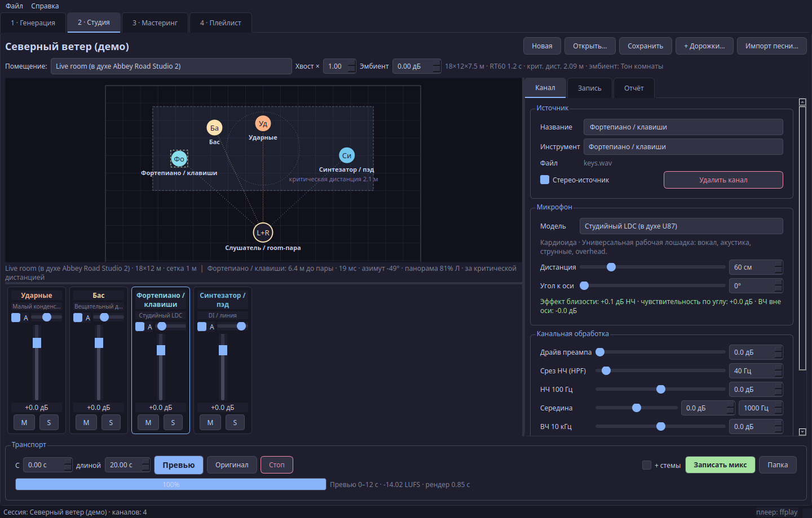

</details>

```bash
pip install -r requirements.txt          # добавляет PyQt5 и инструменты плейлиста
python studio_app.py                     # интерфейс PyQt (на русском)

python studio_cli.py generate --engine demo --title "Северный ветер" --duration 60 --bpm 104 --key "A minor" --out out
python studio_cli.py session "out/Северный ветер/Северный ветер.wav" --scene concert_hall -o out/session
python studio_cli.py render out/session/session.studio.json --format flac --stems
python studio_cli.py list scenes | mics | instruments
```

`generate` принимает также `--style`, `--lyrics`/`--lyrics-file`, `--instrumental`, `--lang`, `--seed`, `--variations`, `--model` и `--extra '{"inference_steps": 8}'` для параметров конкретного движка. Необязательные тяжёлые модели (Demucs, а также AudioSR/Whisper/librosa для старой вкладки мастеринга) — в `requirements-ml.txt`.

</details>

<details>
<summary><b>Переменные окружения</b></summary>

Всё перечисленное ниже есть в настройках приложения; переменные нужны для CLI, приложения на PyQt и CI. Скопируйте `.env.example` в `.env`; `run_studio.command` читает его сам, в терминале выполните `set -a; source .env; set +a`.

| Переменная | Назначение |
|---|---|
| `ACESTEP_API_URL` | сервер ACE-Step, по умолчанию `http://127.0.0.1:8001` |
| `ACESTEP_API_KEY` | ключ, если сервер запущен с авторизацией |
| `GPTUNNEL_API_KEY` | ключ GPTunneL для Suno |
| `GPTUNNEL_PLAYLIST_URL` | ссылка на плейлист для вкладки «Плейлист» в PyQt |
| `GPTUNNEL_ALBUM_NAME` | название альбома в тегах скачанных треков |
| `AMS_PYTHON` | интерпретатор для движка приложения macOS (то же, что Настройки → Движок) |
| `AMS_ENGINE_DIR` | папка движка для приложения macOS, если не встроенная |
| `TELEGRAM_BOT_TOKEN`, `TELEGRAM_CHAT_ID` | публикация в Telegram |
| `YOUTUBE_CLIENT_ID`, `YOUTUBE_CLIENT_SECRET`, `YOUTUBE_REFRESH_TOKEN` | публикация на YouTube (приложение получает refresh token кнопкой **Подключить аккаунт**) |
| `SIGHTENGINE_API_USER`, `SIGHTENGINE_API_SECRET` | проверка Sightengine |
| `ACRCLOUD_TOKEN`, `ACRCLOUD_CONTAINER_ID`, `ACRCLOUD_REGION` | AI-детекция ACRCloud |

</details>

<details>
<summary><b>Тесты</b></summary>

```bash
pip install -r requirements-dev.txt
QT_QPA_PLATFORM=offscreen pytest -q
```

132 тестов на Python покрывают DSP и громкость, инструменты 1.2 (срез спектра, восстановление спектра, бит-в-бит склейку, выравнивание LRC, детектор fakeprint, шаги релиза, встроенное расширение полосы и подгонку по референсу, запросы Telegram/YouTube на mock-серверах, защиту публикации подтверждением, форматы пакета и теги с проверкой через mutagen), рендер во всех десяти помещениях (LUFS в пределах ±1,5, true peak ≤ −0,5 dBTP), панораму от позиции, mute/solo, сессии, протокол сервера движка, протоколы ACE-Step и GPTunneL на локальных mock-серверах и сценарий PyQt от генерации до записи. Задача macOS в CI собирает приложение и запускает `--selftest`, который проводит настоящий движок через генерацию → сессию → смену зала → правку канала → undo → превью → индикаторы → финальный рендер → сохранение → библиотеку → релиз (встроенное расширение полосы, мастер по референсу, обложка, проверка fakeprint, пакет дистрибьютора в WAV и FLAC с тегами) → защиту публикации → склейку → расчёт тайминга записи → русскую локализацию. CI запускает оба набора на каждый push.

</details>

<details>
<summary><b>Структура проекта</b></summary>

```text
AI-Music-Studio/
├── macos/                     # нативное приложение (SwiftUI, Swift Package)
│   ├── Package.swift
│   ├── build_app.sh           # сборка .app и zip
│   ├── Resources/             # иконка
│   └── Sources/AIMusicStudio/ # экраны, состояние, клиент движка, плеер, DSP для кривых
├── studio/
│   ├── engine_server.py       # движок для приложения macOS (JSON-строки)
│   ├── dsp.py  loudness.py  mics.py  scenes.py  session.py  render.py  stems.py  audio_io.py
│   ├── library.py  i18n.py    # обзор папки проекта, тексты на английском и русском
│   ├── generators/            # acestep (генерация + repaint/cover/extract), gptunnel, demo
│   ├── tools.py               # реестр внешних MLX/PyTorch-инструментов, doctor
│   ├── spectrum.py  superres.py  lyrics.py  cover.py  detect.py  refmaster.py  voice.py  editing.py
│   ├── models/fakeprint/      # веса встроенного детектора ИИ (MIT)
│   ├── publish/               # папки релизов, Telegram, YouTube, пакет дистрибьютора, очередь
│   └── ui/                    # интерфейс PyQt5
├── studio_app.py  studio_cli.py
├── full_pipeline.py  gui_pipeline.py  humanize.py  download_playlist.py   # инструменты исходного проекта
├── tests/  scripts/  docs/
└── requirements*.txt  requirements-mlx.md
```

</details>

<details>
<summary><b>Ограничения</b></summary>

- Это моделирование, а не трассировка лучей: отражения — мнимые источники в прямоугольной комнате, хвост — статистическая реверберация.
- Встроенный HPSS делит готовую песню на четыре псевдо-стема (бас, перкуссия, центр, стороны); для чистого выделения вокала нужен Demucs (`requirements-ml.txt`).
- ACE-Step ставится и запускается отдельно; Suno через GPTunneL платный и требует ключ.
- Релизная сборка — для Apple Silicon и без нотаризации; на Intel приложение собирается из исходников через `macos/build_app.sh`.
- Плагины Audio Units не подключаются: рендер выполняет движок на Python.
- Задержка записи берётся из того, что сообщает Core Audio; Bluetooth-наушники добавляют больше, чем сообщают — используйте проводные или регулятор сдвига.
- Публикуя сгенерированную музыку, соблюдайте лицензию модели и правила площадок, включая требования о пометке AI-контента.

</details>

## Лицензия

[MIT](LICENSE). ACE-Step, Suno, GPTunneL, Demucs, AudioSR, Whisper, FlashSR, mflux, Z-Image, Matchering (GPL-3.0, не входит в сборку), mlx-rvc и модели детекторов распространяются по своим лицензиям и условиям. Встроенные веса fakeprint — MIT, см. `studio/models/fakeprint/NOTICE`.

