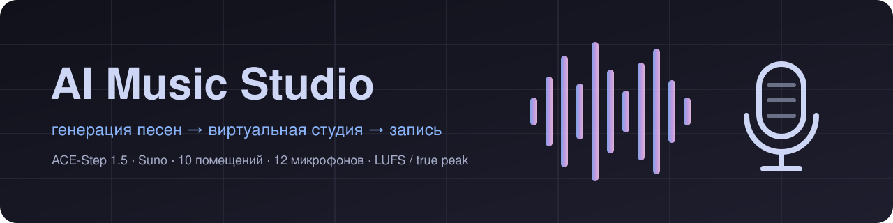
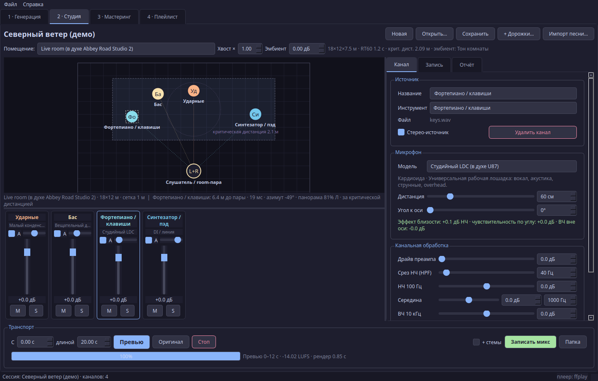

<p align="center"></p>

# AI Music Studio

Desktop app (PyQt5) that generates songs with AI and then lets you "record" them in a virtual studio: place musicians on a stage, choose the room, microphones, preamp, tape and mastering target. The UI is in Russian; the full documentation is in [README.md](README.md).



## Features

- Generation: [ACE-Step 1.5](https://github.com/ace-step/ACE-Step-1.5) via its local REST API (recommended), Suno via the GPTunneL Creative Lab API v2 (paid cloud), and an offline procedural demo synth.
- Stems: engines that return stems are used directly; finished songs are split with built-in HPSS or Demucs.
- Stage: 10 rooms (vocal booth to arena), drag-and-drop musicians, critical distance overlay.
- 12 microphone models with frequency response, polar pattern, proximity effect and self-noise; distance and off-axis angle per channel.
- Channel strip: gain, pan (auto from position), HPF, 3-band EQ, compressor, preamp drive, reverb send, mute/solo.
- Recording: 44.1–96 kHz, 16/24/32-bit, preamps, tape/cassette/vinyl, A-B room pair, stereo width, bus compressor, BS.1770-4 LUFS normalization, 4x oversampled true-peak limiter, dither; WAV/FLAC/ALAC/MP3 export with tags.
- CLI: `studio_cli.py generate | session | render | list`.

## Quick start

```bash
git clone https://github.com/MRX7999/AI-Music-Studio.git && cd AI-Music-Studio
python3 -m venv .venv && source .venv/bin/activate
pip install -r requirements.txt     # + brew install ffmpeg
python studio_app.py
```

Try without any AI backend:

```bash
python studio_cli.py generate --engine demo --title Demo --duration 30 --out out
python studio_cli.py session out/Demo/Demo.wav --scene concert_hall -o out/session
python studio_cli.py render out/session/session.studio.json --format flac --stems
```

Configuration lives in environment variables (see `.env.example`): `ACESTEP_API_URL`, `ACESTEP_API_KEY`, `GPTUNNEL_API_KEY`, `GPTUNNEL_PLAYLIST_URL`, `GPTUNNEL_ALBUM_NAME`.

Tests: `pip install -r requirements-dev.txt && QT_QPA_PLATFORM=offscreen pytest -q`.

When publishing generated music, follow the model license and platform rules, including AI-content disclosure requirements. MIT licensed.
